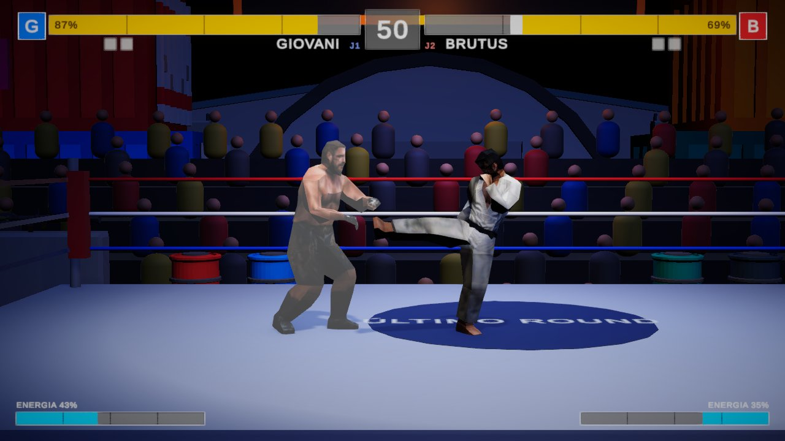
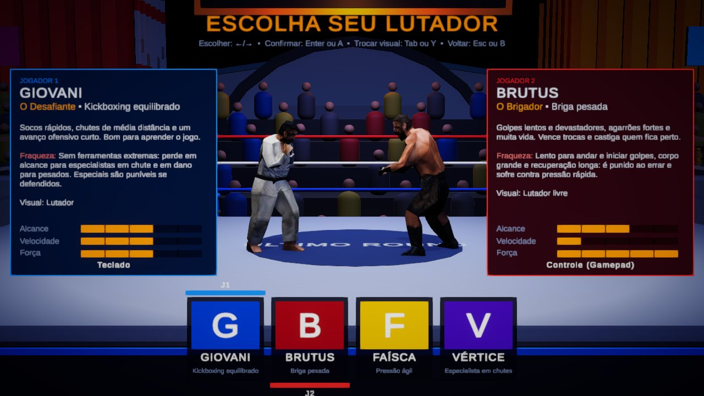
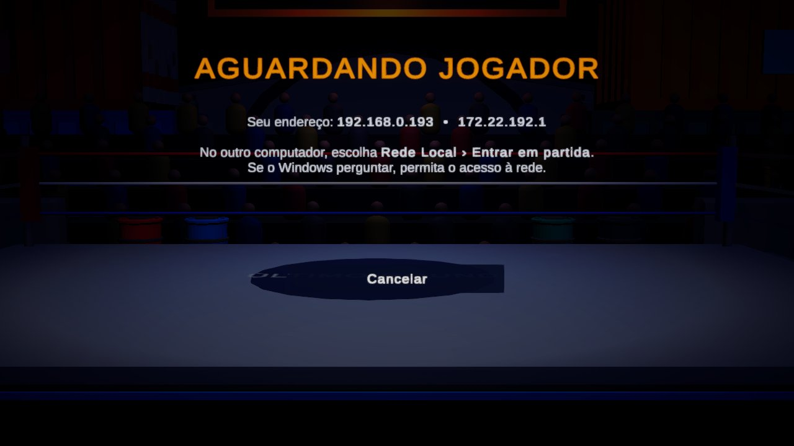
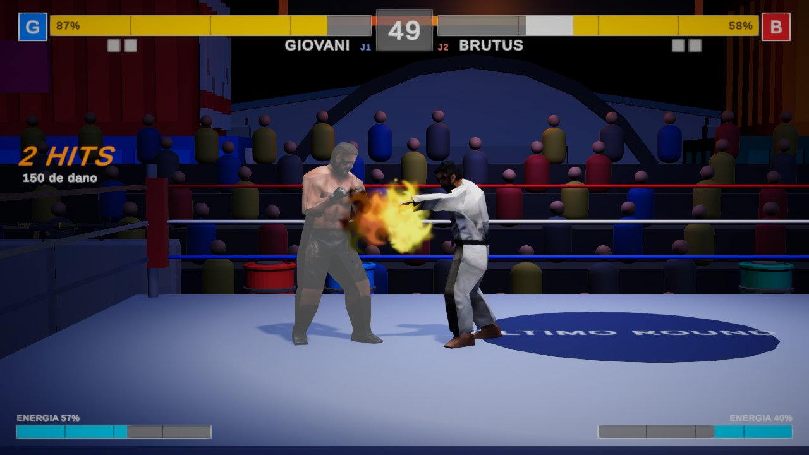
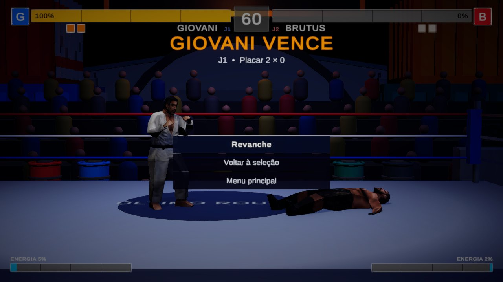

# Último Round — Torneio dos Rivais

Jogo de luta 1 contra 1 para Windows, feito na Unity. Quatro lutadores com estilos diferentes disputam rounds em um ringue montado dentro de uma base militar.

**Autor:** Giovani Nogueira Pires
**Disciplina:** Desenvolvimento de Jogos Digitais — Prof. Luis Filipe Grael Tinós
**Versão:** 1.0.0 · Unity 6000.6.7f1 · Windows 10/11 64 bits



## Baixar e jogar

Os arquivos ficam na página **[Releases](../../releases/latest)** deste repositório.

### Opção 1 — Instalador (recomendado)
1. Baixe `UltimoRound_Setup_v1.0.0.exe`.
2. Abra o arquivo. Se o Windows mostrar *"O Windows protegeu o computador"*, clique em **Mais informações › Executar assim mesmo**. O aviso aparece porque o instalador não tem assinatura digital paga.
3. Siga as telas. Não é preciso permissão de administrador.
4. Abra **Último Round** pelo menu Iniciar ou pelo atalho da área de trabalho.

Para remover, use *Configurações › Aplicativos › Último Round › Desinstalar*.

### Opção 2 — Sem instalar
1. Baixe `UltimoRound_Windows_x64_v1.0.0.zip`.
2. Clique com o botão direito no arquivo, escolha **Extrair tudo** e abra a pasta extraída.
3. Abra `UltimoRound.exe`.

Não abra o `.exe` de dentro do ZIP sem extrair: o jogo precisa da pasta `UltimoRound_Data` ao lado.

### Requisitos
- Windows 10 ou 11, 64 bits.
- Placa de vídeo compatível com DirectX 11.
- Cerca de 270 MB livres.
- Teclado; controle de Xbox ou compatível é opcional.
- Não precisa de internet, conta nem Unity.

## Como jogar



Ao abrir o jogo, pressione qualquer tecla e escolha um modo:

| Modo | Descrição |
|---|---|
| **Versus Local** | Duas pessoas no mesmo computador, cada uma com um dispositivo (teclado + controle ou dois controles) |
| **Rede Local** | Duas pessoas em computadores diferentes, na mesma rede |
| **Contra CPU** | Contra o computador, em três dificuldades |
| **Treino** | Boneco configurável, vida infinita, lista de golpes com demonstração e exibição das caixas de colisão |

Na tela **Associar controles**, cada jogador aperta *Enter* no teclado ou *A* no controle. Na seleção, use as setas para escolher o lutador, *Tab* ou *Y* para trocar o visual e *Enter* ou *A* para confirmar.

### Regras
- **Vitória:** quem vence 2 rounds ganha a partida. Cada round dura 60 segundos.
- **Nocaute:** vence o round quem zerar a vida do adversário.
- **Fim do tempo:** vence quem tiver a maior porcentagem de vida. Se houver empate, o round é repetido.
- **Energia:** acertos e defesas enchem a barra de energia. Com ela cheia, o lutador pode usar o golpe de assinatura.

### Controles padrão

| Ação | Teclado | Controle (Xbox) |
|---|---|---|
| Andar / agachar / pular | A, D / S / W ou Espaço | Analógico ou direcional / baixo / A |
| Soco / Chute / Forte | J / K / L | X / Y / B |
| Defesa (segurar) | I | RT |
| Especial (+ frente para o segundo) | U | RB |
| Agarrão (também escapa) | O | LB |
| Assinatura (energia cheia) | P | LT |
| Pausa | Esc | Start |
| Treino: voltar às posições | R | View/Select |

- **Avanço e recuo:** toque duas vezes para frente ou para trás.
- **Golpe baixo:** baixo + Chute.
- **Antiaéreo:** baixo + Forte.
- **No ar:** os golpes aéreos só podem ser defendidos em pé.
- **Defesa:** golpes baixos só são defendidos agachado.

A lista completa fica em *Pausa › Lista de golpes*. Todos os controles podem ser trocados em *Opções › Controles*.

### Jogar em rede local



1. Os dois computadores precisam estar na mesma rede e com a mesma versão do jogo.
2. **Quem hospeda:** *Rede Local › Hospedar partida*. Se o Windows perguntar, permita o acesso à rede. A tela mostra o endereço do computador.
3. **Quem entra:** *Rede Local › Entrar em partida*. Escolha a partida na lista ou use *Digitar endereço*.

**Se não conectar:**
- Confira se a rede está como *privada* no Windows.
- Confira se o firewall liberou o jogo (porta UDP 47777).
- Redes de faculdade e de convidados costumam bloquear a comunicação entre aparelhos. Nesse caso, use o roteador do celular.

A luta roda no computador de quem hospeda. Quem entra tem um pequeno atraso.

## Conceitos de desenvolvimento de jogos aplicados

| Conceito | Como aparece no jogo | Onde está no código |
|---|---|---|
| Controle de entradas | Teclado e controle com Input System, captura a cada quadro, remapeamento salvo, um dispositivo por jogador e aviso de desconexão | `Scripts/Input` |
| Movimentação | Andar, agachar, pular, avançar, recuar e ser arremessado, com velocidade, gravidade e empurrão | `Scripts/Combat/FightSimulation.cs` |
| Transform e física | Física própria em passo fixo de 60 ticks/s; o `Transform` dos modelos segue as posições da simulação, com interpolação entre ticks | `FightSimulation.cs`, `Scripts/Presentation/FighterView.cs` |
| Colisões e interações | Caixas de ataque, de dano e de empurrão por golpe e por postura; limites do ringue e rebote nas cordas | `FightSimulation.cs`, `MoveDefinition.cs` |
| Pontuação e vitória | Vida, energia, combos com dano reduzido, melhor de 3 rounds, nocaute, fim do tempo e empate | `Scripts/Combat/MatchController.cs` |
| Estados e comportamentos | Máquina de estados do lutador (parado, ataque, atordoado, derrubado, nocaute…), fases da partida e CPU por utilidade com atraso de reação | `CombatTypes.cs`, `MatchController.cs`, `Scripts/AI/CpuBrain.cs` |
| Interface e feedback | HUD com vida, energia, cronômetro e combos; congelamento no impacto, tremor de câmera, efeitos, sons e menus | `Scripts/UI`, `Scripts/Presentation`, `Scripts/Audio` |

O projeto vai além dos itens pedidos: modo treino, inteligência artificial, rede local, instalador e testes automatizados. Os detalhes de design estão no **[GDD](Docs/GDD.md)**.



## Abrir o projeto na Unity

> **Atenção:** os modelos, animações, sons, efeitos e o cenário militar vêm de nove pacotes gratuitos da Unity Asset Store. A licença deles **não permite publicá-los** em um repositório, por isso **não estão aqui**. Sem eles, o projeto abre e roda com a versão de reserva feita por código: lutadores de formas geométricas, sons sintetizados e efeitos simples. A versão completa é a que está em **Releases**.

1. Instale o Unity Hub e a versão **6000.6.7f1** da Unity.
2. Baixe este repositório (*Code › Download ZIP*) e abra a pasta no Unity Hub (*Add › Add project from disk*).
3. Abra a cena `Assets/_Game/Scenes/MainMenu.unity` e aperte **Play**.

### Restaurar a arte completa (opcional)
1. Na Unity Asset Store, adicione os pacotes da tabela de créditos à sua conta. Todos são gratuitos.
2. No *Package Manager › My Assets*, importe cada um nas pastas padrão.
3. Rode, nesta ordem: **Último Round › Assets › 1. Configurar clipes**, **Último Round › Assets › 2. Gerar lutadores, sons e efeitos** e **Último Round › Montar cenas**.

### Ferramentas do menu *Último Round* no editor

| Menu | O que faz |
|---|---|
| *Testes › Rodar EditMode* | Roda os 61 testes automáticos e grava o resultado em `Logs/UltimoRound_TestResults.txt` |
| *Build › Versão de entrega* | Gera o executável, o ZIP e o instalador em `Dist/`. O instalador requer o [Inno Setup 6](https://jrsoftware.org/isinfo.php) |
| *Dados › Regenerar dados padrão* | Recria lutadores e golpes a partir de `Scripts/Data/DefaultRoster.cs` |
| *Montar cenas* | Recria as cenas do jogo |

### Estrutura

```text
Assets/_Game/
  Scripts/Combat        regras da luta (60 ticks/s), sem gráficos
  Scripts/Input         teclado e controle
  Scripts/AI            CPU
  Scripts/Net           rede local (UDP)
  Scripts/Presentation  modelos, animação, câmera e efeitos
  Scripts/UI            menus e HUD feitos por código
  Scripts/Audio         sons e músicas
  Scripts/Core          fluxo das cenas e serviços
  Scripts/Data          dados iniciais dos lutadores e golpes
  Editor                geradores de dados, cenas, build e instalador
  Tests/EditMode        testes automáticos
Docs/                   GDD e documentação técnica
Installer/              script do instalador
```

**Decisão principal:** a simulação decide sozinha dano, estado e vitória, sem animação nem física da Unity. A parte visual apenas lê o resultado. Isso deixa as regras testáveis e iguais em qualquer taxa de quadros.

## Documentação
- [GDD — documento de design do jogo](Docs/GDD.md)
- [Regras de combate e golpes de cada lutador](Docs/COMBAT.md)
- [Testes realizados](Docs/TESTS.md)
- [Limitações conhecidas](Docs/KNOWN_ISSUES.md)
- [Origem e licença dos assets](Docs/ASSETS.md)

## Créditos

**Desenvolvimento:** Giovani Nogueira Pires, com apoio de inteligência artificial (Claude Code, da Anthropic), permitido na disciplina.

**Pacotes gratuitos da Unity Asset Store** (usados na versão em Releases e não incluídos neste repositório):

| Pacote | Autor | Uso |
|---|---|---|
| Low Poly Fighter Starter Pack | tt-3D | Modelos dos lutadores |
| Fighter Pack Bundle FREE | Explosive | Modelos e animações |
| Fighting Motions Vol.1 | Magicpot Inc | Animações de golpes |
| Survivalist character | Slayver | Modelo e animações |
| Zombie Monster Animations FREE | Kevin Iglesias | Modelo e animações |
| Free Deadly Kombat | Daniel SoundsGood | Sons de luta |
| Free Quick Effects Vol.1 | Gabriel Aguiar Prod | Efeitos especiais |
| Military Base Pack | Tiny Teacup Studio | Cenário |
| Low Poly Weapons VOL.1 | Simon Mercuzot | Decoração do cenário |

**Outros:** fonte Liberation Sans (SIL Open Font License) e instalador feito com [Inno Setup](https://jrsoftware.org/isinfo.php).

## Limitações
- Os visuais vêm de pacotes genéricos; os lutadores não têm aparência exclusiva.
- Não há jogo pela internet, só em rede local. Em rede local, quem hospeda não tem atraso.
- O balanceamento foi testado pouco com pessoas.

Lista completa em [KNOWN_ISSUES.md](Docs/KNOWN_ISSUES.md).


